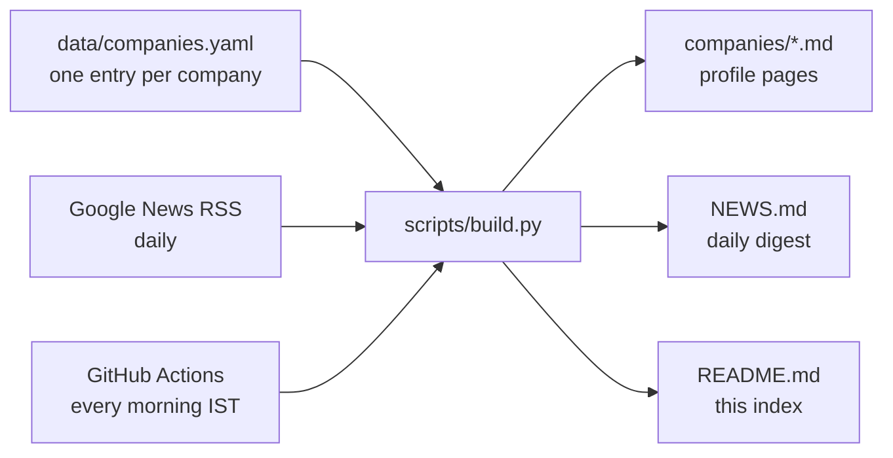

  
  
  
  

<b>One place to follow what the world's leading technology and life-science companies are building, buying and planning.</b> 
75 companies across the USA, UK and India · a profile page for each · news and strategy headlines refreshed automatically every morning.

  <a href="NEWS.md"><b>📰 Today's digest</b></a> ·
  <a href="#-the-radar">🗂️ All companies</a> ·
  <a href="#-free-intelligence-toolkit">🧰 Free intelligence toolkit</a> ·
  <a href="#-how-it-works">⚙️ How it works</a>

---

## 🧭 What each profile gives you

| Section | What you get |
|:--|:--|
| 🔗 **Quick links** | Official website, research lab, investor relations, careers, Google News and a one-click Google Alert |
| 🧰 **Free tools** | The company's free learning platforms, developer tools, research portals and free tiers |
| 🔭 **Strategy & future plans** | Last 30 days of headlines on roadmaps, launches, investments, acquisitions and partnerships |
| 📰 **Latest news** | The past week's coverage, newest first |
| 🧪 **Clinical trials** | For pharma and medtech: a live ClinicalTrials.gov search of the company's sponsored trials — the clearest public view of its pipeline |

---

## 🗂️ The radar

### 🇺🇸 USA · Technology

| Company | Focus | Profile | Headlines this week |
|:--|:--|:--|--:|
| [**Microsoft**](https://www.microsoft.com) | Cloud, AI, software | [Open →](companies/microsoft.md) | — |
| [**Apple**](https://www.apple.com) | Consumer technology | [Open →](companies/apple.md) | — |
| [**NVIDIA**](https://www.nvidia.com) | AI chips, semiconductors, accelerated computing | [Open →](companies/nvidia.md) | — |
| [**Alphabet (Google)**](https://abc.xyz) | Search, AI, cloud | [Open →](companies/alphabet-google.md) | — |
| [**Amazon**](https://www.aboutamazon.com) | Cloud (AWS), e-commerce, AI | [Open →](companies/amazon.md) | — |
| [**Meta Platforms**](https://about.meta.com) | AI, social platforms, mixed reality | [Open →](companies/meta-platforms.md) | — |
| [**Oracle**](https://www.oracle.com) | Enterprise software, cloud, health records | [Open →](companies/oracle.md) | — |
| [**Salesforce**](https://www.salesforce.com) | CRM, enterprise AI agents | [Open →](companies/salesforce.md) | — |
| [**Adobe**](https://www.adobe.com) | Creative and document software, generative AI | [Open →](companies/adobe.md) | — |
| [**IBM**](https://www.ibm.com) | Enterprise AI, hybrid cloud, quantum, consulting | [Open →](companies/ibm.md) | — |
| [**Intel**](https://www.intel.com) | Semiconductors, foundry | [Open →](companies/intel.md) | — |
| [**AMD**](https://www.amd.com) | CPUs, GPUs, AI accelerators | [Open →](companies/amd.md) | — |
| [**Qualcomm**](https://www.qualcomm.com) | Wireless, mobile and edge-AI chips | [Open →](companies/qualcomm.md) | — |
| [**Cisco**](https://www.cisco.com) | Networking, cybersecurity | [Open →](companies/cisco.md) | — |
| [**Palantir Technologies**](https://www.palantir.com) | AI platforms, data analytics | [Open →](companies/palantir-technologies.md) | — |
| [**Tesla**](https://www.tesla.com) | Electric vehicles, energy storage, solar, autonomy, robotics | [Open →](companies/tesla.md) | — |
| [**SpaceX (incl. xAI, X, Grok)**](https://www.spacex.com) | Launch, Starlink, AI (Grok), social platform X | [Open →](companies/spacex-incl-xai-x-grok.md) | — |
| [**Anthropic**](https://www.anthropic.com) | Frontier AI research and the Claude models | [Open →](companies/anthropic.md) | — |

### 🌐 Consulting & Market Intelligence

| Company | Focus | Profile | Headlines this week |
|:--|:--|:--|--:|
| [**Accenture**](https://www.accenture.com) | Consulting, technology services, AI transformation | [Open →](companies/accenture.md) | — |
| [**GlobalData PLC**](https://www.globaldata.com) | Data, analytics and market intelligence | [Open →](companies/globaldata-plc.md) | — |

### 🇬🇧 UK · Technology

| Company | Focus | Profile | Headlines this week |
|:--|:--|:--|--:|
| [**Arm Holdings**](https://www.arm.com) | Semiconductor architecture | [Open →](companies/arm-holdings.md) | — |
| [**Sage Group**](https://www.sage.com) | Business and accounting software | [Open →](companies/sage-group.md) | — |
| [**RELX**](https://www.relx.com) | Information analytics (Elsevier, LexisNexis) | [Open →](companies/relx.md) | — |
| [**Wise**](https://wise.com) | Financial technology, cross-border payments | [Open →](companies/wise.md) | — |
| [**Revolut**](https://www.revolut.com) | Digital finance | [Open →](companies/revolut.md) | — |
| [**Darktrace**](https://www.darktrace.com) | AI cybersecurity | [Open →](companies/darktrace.md) | — |
| [**Ocado Group**](https://www.ocadogroup.com) | Robotics, warehouse automation | [Open →](companies/ocado-group.md) | — |
| [**Monzo**](https://monzo.com) | Digital banking | [Open →](companies/monzo.md) | — |
| [**Bytes Technology Group**](https://www.bytes.co.uk) | IT services, software licensing | [Open →](companies/bytes-technology-group.md) | — |
| [**Kainos**](https://www.kainos.com) | Digital transformation | [Open →](companies/kainos.md) | — |

### 🇮🇳 India · Technology

| Company | Focus | Profile | Headlines this week |
|:--|:--|:--|--:|
| [**Tata Consultancy Services**](https://www.tcs.com) | IT services, consulting | [Open →](companies/tata-consultancy-services.md) | — |
| [**Infosys**](https://www.infosys.com) | IT, digital transformation | [Open →](companies/infosys.md) | — |
| [**HCLTech**](https://www.hcltech.com) | Engineering, IT services | [Open →](companies/hcltech.md) | — |
| [**Wipro**](https://www.wipro.com) | Technology consulting | [Open →](companies/wipro.md) | — |
| [**Tech Mahindra**](https://www.techmahindra.com) | IT, telecom technology | [Open →](companies/tech-mahindra.md) | — |
| [**LTIMindtree**](https://www.ltimindtree.com) | Cloud, data, AI | [Open →](companies/ltimindtree.md) | — |
| [**Persistent Systems**](https://www.persistent.com) | Software engineering | [Open →](companies/persistent-systems.md) | — |
| [**Coforge**](https://www.coforge.com) | Digital engineering, IT | [Open →](companies/coforge.md) | — |
| [**Zoho Corporation**](https://www.zoho.com) | Enterprise SaaS | [Open →](companies/zoho-corporation.md) | — |
| [**Freshworks**](https://www.freshworks.com) | Customer-service software | [Open →](companies/freshworks.md) | — |

### 🇺🇸 USA · Healthcare & Life Sciences

| Company | Focus | Profile | Headlines this week |
|:--|:--|:--|--:|
| [**Johnson & Johnson**](https://www.jnj.com) | Pharma, medical technology | [Open →](companies/johnson-johnson.md) | — |
| [**UnitedHealth Group**](https://www.unitedhealthgroup.com) | Healthcare services, insurance | [Open →](companies/unitedhealth-group.md) | — |
| [**Eli Lilly**](https://www.lilly.com) | Pharmaceuticals | [Open →](companies/eli-lilly.md) | — |
| [**Merck & Co.**](https://www.merck.com) | Pharmaceuticals, vaccines | [Open →](companies/merck-co.md) | — |
| [**Pfizer**](https://www.pfizer.com) | Pharmaceuticals, vaccines | [Open →](companies/pfizer.md) | — |
| [**AbbVie**](https://www.abbvie.com) | Biopharmaceuticals | [Open →](companies/abbvie.md) | — |
| [**Amgen**](https://www.amgen.com) | Biotechnology | [Open →](companies/amgen.md) | — |
| [**Bristol Myers Squibb**](https://www.bms.com) | Biopharmaceuticals | [Open →](companies/bristol-myers-squibb.md) | — |
| [**Abbott Laboratories**](https://www.abbott.com) | Diagnostics, medical devices | [Open →](companies/abbott-laboratories.md) | — |
| [**Boston Scientific**](https://www.bostonscientific.com) | Medical devices | [Open →](companies/boston-scientific.md) | — |
| [**Stryker**](https://www.stryker.com) | Medical technology | [Open →](companies/stryker.md) | — |
| [**Becton Dickinson (BD)**](https://www.bd.com) | Medical devices, diagnostics | [Open →](companies/becton-dickinson-bd.md) | — |
| [**GE HealthCare**](https://www.gehealthcare.com) | Medical imaging, diagnostics | [Open →](companies/ge-healthcare.md) | — |
| [**Thermo Fisher Scientific**](https://www.thermofisher.com) | Life-science technologies | [Open →](companies/thermo-fisher-scientific.md) | — |
| [**Gilead Sciences**](https://www.gilead.com) | Biopharmaceuticals | [Open →](companies/gilead-sciences.md) | — |

### 🇬🇧 UK · Healthcare & Life Sciences

| Company | Focus | Profile | Headlines this week |
|:--|:--|:--|--:|
| [**AstraZeneca**](https://www.astrazeneca.com) | Biopharmaceuticals | [Open →](companies/astrazeneca.md) | — |
| [**GSK**](https://www.gsk.com) | Pharmaceuticals, vaccines | [Open →](companies/gsk.md) | — |
| [**Haleon**](https://www.haleon.com) | Consumer healthcare | [Open →](companies/haleon.md) | — |
| [**Smith+Nephew**](https://www.smith-nephew.com) | Medical devices | [Open →](companies/smith-nephew.md) | — |
| [**Bupa**](https://www.bupa.com) | Healthcare services, insurance | [Open →](companies/bupa.md) | — |
| [**Oxford Nanopore Technologies**](https://nanoporetech.com) | Genomic sequencing | [Open →](companies/oxford-nanopore-technologies.md) | — |
| [**Oxford Biomedica**](https://www.oxb.com) | Cell and gene therapy services | [Open →](companies/oxford-biomedica.md) | — |
| [**Convatec**](https://www.convatecgroup.com) | Medical technology | [Open →](companies/convatec.md) | — |

### 🇮🇳 India · Healthcare & Life Sciences

| Company | Focus | Profile | Headlines this week |
|:--|:--|:--|--:|
| [**Sun Pharmaceutical Industries**](https://sunpharma.com) | Pharmaceuticals | [Open →](companies/sun-pharmaceutical-industries.md) | — |
| [**Dr. Reddy's Laboratories**](https://www.drreddys.com) | Pharmaceuticals | [Open →](companies/dr-reddy-s-laboratories.md) | — |
| [**Cipla**](https://www.cipla.com) | Pharmaceuticals, respiratory care | [Open →](companies/cipla.md) | — |
| [**Lupin**](https://www.lupin.com) | Pharmaceuticals | [Open →](companies/lupin.md) | — |
| [**Aurobindo Pharma**](https://www.aurobindo.com) | Generic pharmaceuticals | [Open →](companies/aurobindo-pharma.md) | — |
| [**Biocon**](https://www.biocon.com) | Biotechnology, biosimilars | [Open →](companies/biocon.md) | — |
| [**Divi's Laboratories**](https://www.divislabs.com) | APIs, pharmaceutical ingredients | [Open →](companies/divi-s-laboratories.md) | — |
| [**Zydus Lifesciences**](https://www.zyduslife.com) | Pharmaceuticals, vaccines | [Open →](companies/zydus-lifesciences.md) | — |
| [**Torrent Pharmaceuticals**](https://www.torrentpharma.com) | Pharmaceuticals | [Open →](companies/torrent-pharmaceuticals.md) | — |
| [**Apollo Hospitals Enterprise**](https://www.apollohospitals.com) | Hospitals, healthcare services | [Open →](companies/apollo-hospitals-enterprise.md) | — |
| [**Max Healthcare Institute**](https://www.maxhealthcare.in) | Hospital networks | [Open →](companies/max-healthcare-institute.md) | — |
| [**Fortis Healthcare**](https://www.fortishealthcare.com) | Hospitals, diagnostics | [Open →](companies/fortis-healthcare.md) | — |

---

## 🧰 Free intelligence toolkit

The same free sources analysts use to track companies:

| Need | Free tool |
|:--|:--|
| US company filings (10-K, 10-Q, 8-K) | [SEC EDGAR full-text search](https://efts.sec.gov/LATEST/search-index?q=) · [EDGAR company search](https://www.sec.gov/edgar/search/) |
| UK company filings | [Companies House](https://find-and-update.company-information.service.gov.uk) |
| Indian company filings | [MCA21](https://www.mca.gov.in) · [NSE announcements](https://www.nseindia.com/companies-listing/corporate-filings-announcements) · [BSE announcements](https://www.bseindia.com/corporates/ann.html) |
| Drug & device pipelines | [ClinicalTrials.gov](https://clinicaltrials.gov) · [CTRI (India)](https://ctri.nic.in) · [EU Clinical Trials Register](https://www.clinicaltrialsregister.eu) |
| Regulatory approvals | [FDA Drugs@FDA](https://www.accessdata.fda.gov/scripts/cder/daf/) · [FDA device clearances](https://www.accessdata.fda.gov/scripts/cdrh/cfdocs/cfpmn/pmn.cfm) · [CDSCO](https://cdsco.gov.in) |
| Patents (what they're inventing) | [Google Patents](https://patents.google.com) · [WIPO PATENTSCOPE](https://patentscope.wipo.int) · [Indian Patent Search](https://iprsearch.ipindia.gov.in/publicsearch) |
| Research output | [Google Scholar](https://scholar.google.com) · [OpenAlex](https://openalex.org) · [Semantic Scholar](https://www.semanticscholar.org) |
| Open-source activity | [GitHub Explore](https://github.com/explore) · [OSS Insight](https://ossinsight.io) |
| Hiring signals | [LinkedIn Jobs](https://www.linkedin.com/jobs/) · company careers pages (linked on each profile) |
| News alerts | [Google Alerts](https://www.google.com/alerts) · [Google News](https://news.google.com) |
| Market data | [Google Finance](https://www.google.com/finance) · [Yahoo Finance](https://finance.yahoo.com) · [Screener.in](https://www.screener.in) (India) |

---

## ⚙️ How it works

- **Add a company:** append it to [`data/companies.yaml`](data/companies.yaml) and open a pull request — the page builds itself.
- **Accuracy:** the curated parts (focus, links, tools) are reviewed by hand; the news sections are automated headlines and links. Always confirm important facts with the company's own releases and filings.
- **Not investment advice.** This is a research and learning resource.

---

## 🔗 Part of the Open Knowledge series

| Learn | Track |
|:--|:--|
| [Awesome Biotechnology](https://github.com/Subhadeep998/Awesome-Biotechnology) · [Awesome AI Learning](https://github.com/Subhadeep998/Awesome-AI-Learning) · [Open Biology Handbook](https://github.com/Subhadeep998/Open-Biology-Handbook) | [Science Research Radar](https://github.com/Subhadeep998/Science-Research-Radar) · **Global Company Radar** · [Law Firm Radar](https://github.com/Subhadeep998/Law-Firm-Radar) · [AI Developer Docs Hub](https://github.com/Subhadeep998/AI-Developer-Docs-Hub) |

  ⭐ <b>Star</b> to bookmark · 👤 <a href="https://github.com/Subhadeep998"><b>Follow @Subhadeep998</b></a> for more open intelligence 
  Built by <a href="https://subhadeep998.github.io">Subhadeep Aditya</a> — healthcare intelligence analyst (ex-GlobalData, Vatrix, GHX) · Kolkata, India

